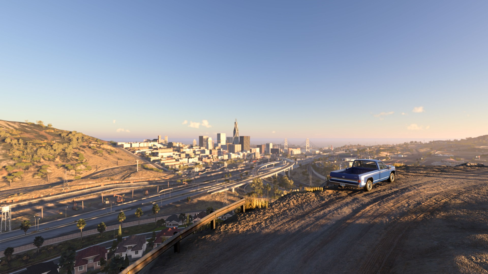
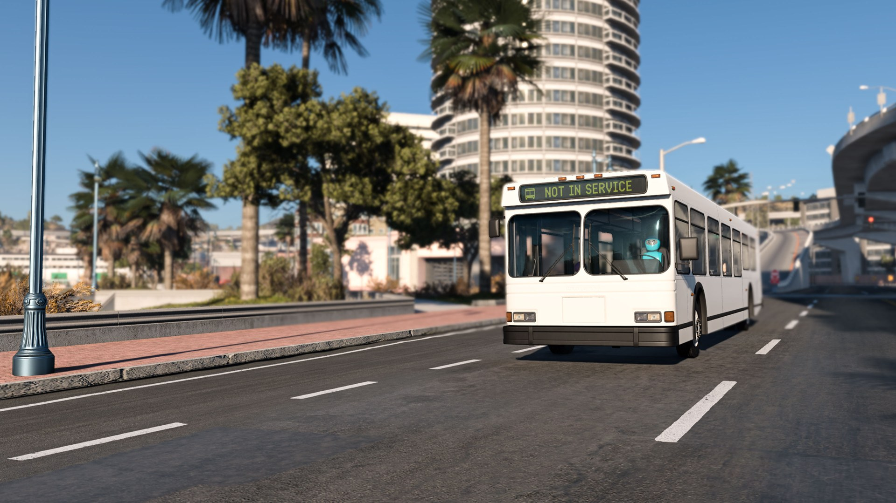

# RLS Career Overhaul

Build a career around the way you like to drive. Race, deliver cargo, run businesses, work shifts, buy and build cars, or take a different route through police work and off-road events.

**v2.8.0 Public Release · BeamNG.drive 0.40.3**

[Download v2.8.0](https://github.com/RLS-Modding/rls_career_overhaul/releases/latest) · [Getting started](https://github.com/RLS-Modding/rls_career_overhaul/wiki/Installation) · [Wiki](https://github.com/RLS-Modding/rls_career_overhaul/wiki) · [Report a bug](https://github.com/RLS-Modding/rls_career_overhaul/issues)

## Your career

Overhaul has its own career mode, saves and RLS West Coast map. Start a new career or import an older RLS career as a separate copy, keeping the original save.

- **Jobs and deliveries:** Find work in Job Broker, group matching jobs in My Loads, and haul parcels, materials, fluids and vehicles with suitable equipment.
- **Shifts and passengers:** Work for employers, drive taxis and buses, and take on recovery, quarry and facility work.
- **Cars and garages:** Shop dealerships, negotiate purchases, manage storage, sell through the Marketplace, and buy or list vehicles at auction.
- **Workshops and businesses:** Build and manage engines, tune vehicles, organise fleet work, and track business finances.
- **Racing and events:** Run drag, circuit, rally, drift, crawling and other events. Compatible map courses can use the shared Dakar system.
- **Police and insurance:** Take police work, deal with pursuits and fines, and choose coverage and repairs for your cars.
- **Money and progression:** Track income and spending in Wallet, review activity in Logbook History, and build skills as you play.

Available jobs, facilities and events depend on your map, equipment and career progress.

## What's new in v2.8.0

- Separate career mode and a clearer path for importing older RLS saves.
- Refreshed phone apps, controller navigation and shortcut setup.
- Wallet, expanded financial history and a redesigned Pause Home.
- Better delivery progress, pickups, shifts and map travel.
- Improved garage, engine, auction and repair flows.
- Four rotating autosaves and stronger save recovery.
- Lighter menus, less background processing and long-session cleanup.
- Updated Dakar controls and a smoother compass.

[Read the full changelog](https://github.com/RLS-Modding/rls_career_overhaul/releases/tag/v2.8.0).

## Install

1. Download **`rls_career_overhaul_v2.8.0.zip`** from the [release Assets](https://github.com/RLS-Modding/rls_career_overhaul/releases/latest).
2. In the BeamNG launcher, open **Manage User Folder → Open in Explorer**. Use the user folder for the profile you actually play.
3. Put the ZIP in its `mods` folder. Leave it zipped.
4. Remove or disable older Overhaul copies, including unpacked copies. Enable the new version in the Mod Manager and restart the game after changing versions.
5. Open **RLS Career Overhaul** from its main-menu or Career-screen entry.

Use the named release ZIP for installation. You do not need to build anything from this repository.

## Returning players

Back up your saves before updating. In the Overhaul profile screen, choose **Load** on a detected older RLS career to open its **Compatibility report**. Continue to **Choose what to keep**, review any keep/cash-out choices, then choose **Create migrated copy**. The original save stays untouched. Stock-only careers are not supported by this importer.

If your save is missing, check that you opened the same BeamNG user folder/profile where it was saved. Do not delete or overwrite the original to make it appear. See [Saves and migration](https://github.com/RLS-Modding/rls_career_overhaul/wiki/Saves-and-Migration).

The final page of the update intro lets you choose a phone shortcut. Existing custom bindings stay saved. You can also manage the shortcut through the phone’s **Controls** app; there is no default phone shortcut for a fresh setup. If you skipped setup or cannot open the phone, use **Options → Controls**, search for **Toggle Phone**, and assign a key or controller button there.

## Maps

RLS West Coast is included. Additional career maps are installed as map mods, with their career locations and data bundled in the same download. Use a map version compatible with your Overhaul release. Available jobs, facilities and events vary by map.

## Help and bug reports

Start with the [troubleshooting guide](https://github.com/RLS-Modding/rls_career_overhaul/wiki/Troubleshooting), then search [existing issues](https://github.com/RLS-Modding/rls_career_overhaul/issues) before opening another report.

Include:

- BeamNG and Overhaul versions, map versions.
- Whether the save is new or migrated.
- Steps to reproduce, what you expected and what happened.
- A screenshot or short video, and `beamng.log` from the affected session.
- Whether it also happens with only Overhaul and its required map files enabled.

Keep save backups when troubleshooting. Check logs for personal paths or other information you do not want to share.

## Credits

Created and maintained by **RLS Modding**, with help from contributors, testers and the community. See the [contributors](https://github.com/RLS-Modding/rls_career_overhaul/graphs/contributors) and bundled `licenses` for included third-party material.

RLS Career Overhaul is a community mod and is not affiliated with BeamNG GmbH.

## Licensing

Original RLS source listed in the [license scope](licenses/RLS-AGPL-SCOPE.md) is AGPLv3-only with a BeamNG additional permission. BeamNG-derived files and included components retain their applicable licenses. See [Licensing](LICENSING.md) and [third-party notices](THIRD_PARTY_NOTICES.md).
